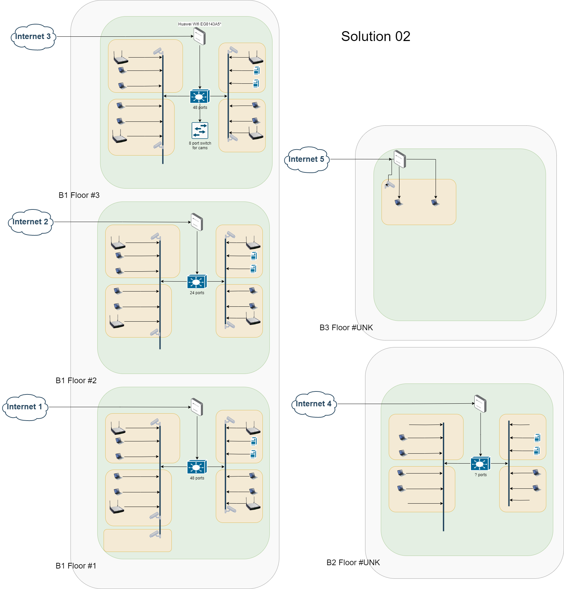

# AlMidrar_SiteSurvey
## Introduction 
The purpose of this networking site survey was to assess the current network infrastructure and performance of the Al-Midrar to identify potential areas for improvement. The survey was conducted by the Fizan, Shah Meer and Kashif on Friday 21 July 2023.
## Objectives
The primary objectives of the networking site survey were as follows:
- Evaluate the existing network topology, equipment, services and configurations.
- Identify network performance issues and bottlenecks.
- Recommend improvements to enhance the overall network efficiency, cost and reliability.
## Methodology
- [Done] Initial Consultation: Discussions with the IT team to understand the current network setup, challenges faced, and objectives.
- [Done] Physical Inspection: On-site examination of the networking equipment, cabling, and network rooms.
- [Planed for next visit] Network Performance Testing: Utilizing specialized software to analyze network speed, latency, and throughput.
- [Planed for next visit] User Interviews: Obtaining feedback from employees regarding their network experience and pain points.
## Current Setup and Network Infrastructure
- Buildings : 3 | Floors : 5 | Rooms : 13
- Network Topology: Mesh Wifi
- Network Equipment: 
  - Wifi Routers : 13 (4*30mbps+9*30mbps = 430 mbps)
- Network Configuration: Default
- List of clients : (Total 210+1) 
  - Smartphones(Wifi) : 92
  - Laptops/PC(Wifi) : 92
  - CCTV Cameras(Wifi) : 26
  - Attendance Machine(unknown interface) : 1 
## Findings
1. All clients are connected via Wifi
2. 13 Internet connections
3. No Bandwidth policy is configured
4. Data is stored in local PCs
5. Mostly used services are : whatsapp, zoom, video uploading 

| Building # | Floor# | Room # | Routers                | Router WAN | Router Eth out Tx1000 | ISP Bandwidth (mbps) | Mostly Used Services                  | Wifi Smartphones | Wifi Laptop/PC | Wifi CCTV CAMs | Ethernet Nodes | Total Nodes | Networks Policies | Ideal Bandwidth / User (mbps) | Remarks          |
| ---------- | ------ | ------ | ---------------------- | ---------- | --------------------- | -------------------- | ------------------------------------- | ---------------- | -------------- | -------------- | -------------- | ----------- | ----------------- | ----------------------------- | ---------------- |
| 1          | 1      | 1      | Huawei Wifi EG8143A5\* | Optical    | 4                     | 40                   | WhatsApp + CCTV                       | 8                | 8              | 2              | 0              | 18          | Default           | 2.222222222                   |                  |
| 1          | 1      | 2      | Huawei Wifi EG8143A5\* | Optical    | 4                     | 40                   | WhatsApp + CCTV                       | 8                | 8              | 2              | 0              | 18          | Default           | 2.222222222                   |                  |
| 1          | 1      | 3      | Huawei Wifi EG8143A5\* | Optical    | 4                     | 30                   | WhatsApp + CCTV                       | 8                | 8              | 2              | 0              | 18          | Default           | 1.666666667                   |                  |
| 1          | 1      | 4      | Huawei Wifi EG8143A5\* | Optical    | 4                     | 30                   | WhatsApp + Video Streaming Up + CCTV  | 8                | 8              | 2              | 0              | 18          | Default           | 1.666666667                   |                  |
| 1          | 2      | 1      | Huawei Wifi EG8143A5\* | Optical    | 4                     | 30                   | Video Streaming Up/Down + Zoom + CCTV | 4                | 4              | 2              | 0              | 10          | Default           | 3                             |                  |
| 1          | 2      | 1      | Huawei Wifi EG8143A5\* | Optical    | 4                     | 30                   | Video Streaming Up/Down + Zoom + CCTV | 4                | 4              | 2              | 0              | 10          | Default           | 3                             |                  |
| 1          | 2      | 2      | Huawei Wifi EG8143A5\* | Optical    | 4                     | 30                   | Video Streaming Up/Down + Zoom + CCTV | 4                | 4              | 2              | 0              | 10          | Default           | 3                             |                  |
| 1          | 2      | 3      | Huawei Wifi EG8143A5\* | Optical    | 4                     | 40                   | Video Streaming Up/Down + Zoom + CCTV | 4                | 4              | 2              | 0              | 10          | Default           | 4                             |                  |
| 1          | 3      | 1      | Huawei Wifi EG8143A5\* | Optical    | 4                     | 40                   | WhatsApp + CCTV                       | 14               | 14             | 2              | 0              | 30          | Default           | 1.333333333                   |                  |
| 1          | 3      | 2      | Huawei Wifi EG8143A5\* | Optical    | 4                     | 30                   | WhatsApp + CCTV                       | 14               | 14             | 2              | 0              | 30          | Default           | 1                             |                  |
| 1          | 3      | 3      | Huawei Wifi EG8143A5\* | Optical    | 4                     | 30                   | WhatsApp + CCTV                       | 14               | 14             | 2              | 0              | 30          | Default           | 1                             |                  |
| 2          | UNK    | 1      | Huawei Wifi EG8143A5\* | Optical    | 4                     | 30                   | WhatsApp + CCTV                       | 2                | 2              | 2              | 0              | 6           | Default           | 5                             |                  |
| 3          | UNK    | 1      | Huawei Wifi EG8143A5\* | Optical    | 4                     | 30                   | WhatsApp + CCTV                       | 0                | 0              | 2              | 0              | 2           | Default           | 15                            | Future Expansion |
| 3          | 4      | 13     | 13                     |            | 52                    | 430                  |                                       | 92               | 92             | 26             | 0              | 210         |                   |                               |
## Recommendations
- Shift all Laptop/Pc and CCTV from wifi to wired network
- Implement Quality of Service (QoS) policies to prioritize critical applications during periods of high traffic(required managed switches).
- Reduce no of internet connections from 13 to 4-5 and upgrade bandwidth plans
### Benefits of Wired Network Conversion
- Enhanced Network Performance: Wired connections generally provide faster and more reliable data transfer compared to wireless.
- Reduced Interference: Eliminating Wi-Fi signals reduces potential interference issues in crowded or congested environments.
- Enhanced Security: Wired networks offer a higher level of security compared to wireless, as they are not susceptible to unauthorized access via Wi-Fi hacking.
## Challenges and Considerations
- Disruptions during Installation: The conversion process may cause temporary disruptions to network services while cabling and equipment are installed.
- Cost: Converting to a wired network may involve significant upfront costs for cabling, switches, and other hardware.
- Physical Constraints: The physical layout of the office may present challenges in running cables to certain areas.
## Proposed Solutions
### 01 Convert with existing Internet connection
- 12 Unmanaged network switches shall be added with each router
- All Laptop/PC and CCTV cams shall be conrverted into wired network
#### Pros
- Cost effective (infrastructure wise)
- No new connection are required
#### Cons
- Hard to manage because using 13 different connections
- High running cost (13 connections)
#### Diagram 
#### Required Hardware
- 12 16-ports unmanaged switches
- Cat 6 cable (need site survey)
- Channels for cable
- Power cable
### 02 Restructured whole Infrastructure
- 4-5 internet connections required
- 4 Managed switches shall be installed on each floor of building
- 10-12 Wifi Routers shall be installed on each room for smartphones(92+)
#### Pros
- 4-5 internet connections shall required intead of 13
- Low running runinng cost
- Can manage resousrces of all nodes via console (bandwidth control, access control ....)
- User can also access CCTV cams/nodes via local network intead of using internet accross all floors*. 
#### Cons
- High one time Infrastructure cost
- Need dedicated network admin
#### Diagram 

#### Requried Hardware
- 2 48-ports L3 switches
- 1 24-ports unmanged switch
- 12 Tp-Link 2.4g routers(dual band could be better option but twice in price)
- Cat 6 cable (need site survey)
- Power cable
- Channels for Cable
- 4 4u Wall mount network rack (if required)
## Conclusion
The networking site survey indicates that converting the Wi-Fi-based network at ALMidrar to a wired network is a viable option. The transition offers significant benefits in terms of network performance, reliability, and security. However, careful planning, resource allocation, and coordination with the IT team will be necessary to ensure a successful and smooth conversion process.